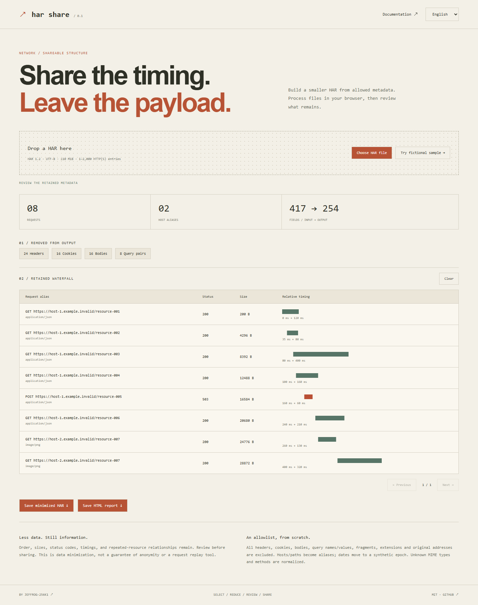

# HAR Share

[English](README.md) · [한국어](README.ko.md) · [简体中文](README.zh-CN.md) · [日本語](README.ja.md) · [Español](README.es.md)

Build a minimal network archive before sharing a HAR. Headers, cookies, bodies, query names and values, original addresses, and extension fields never enter the new file.

[Try it](https://jeffrog-256k1.github.io/har-share/) · [MIT](LICENSE) · [Changelog](CHANGELOG.md)



## Run locally

Node.js 22.12+ · npm

```sh
git clone https://github.com/jeffrog-256k1/har-share.git
cd har-share
npm ci
npm run build
npm run dev
# Open the local URL printed by Vite.
```

Choose or drop a UTF-8 HAR 1.2 file, or load the fictional sample. Review removal counts and the retained waterfall. Export minimized HAR or a standalone HTML report. Both downloads use fixed names. Clear removes the current UI result; nothing is saved automatically. UI and documentation support five languages.

## How it works

The output is built from scratch: allowlisted HTTP method, status, MIME type, response sizes, timing phases, and request ordering. Hosts and paths become stable example.invalid aliases, including repeated resources. Query names/values and fragments are dropped entirely. Dates move to 2000-01-01 plus the original relative offset. No original page title, IP, connection ID, redirect target, header, cookie, payload, custom field, or filename is retained.

Standard methods are GET, POST, PUT, PATCH, DELETE, HEAD, OPTIONS, CONNECT, TRACE; all others become OTHER. Common MIME types are allowlisted in src/core.ts; unknown types become application/octet-stream and parameters are removed. HTTP versions become the placeholder HTTP/1.1, status text becomes empty, header sizes and request body size become -1. Total duration is recalculated from retained timing phases, excluding SSL already included in connect. Input/output field counts describe each structure; their difference is not a count of deleted secrets.

## Scope and limits

Limits: 10 MiB, HAR 1.2, 1–2,000 HTTP(S) entries, timestamps spanning ≤7 days, individual timing phases and total duration ≤24 hours, size fields ≤1 TB. Required numbers must be finite; sizes/status must be integers. send/wait/receive must be nonnegative; optional phases may be -1. Unknown/invalid structures fail closed. Archives with missing required timing/size data, data: URLs, WebSockets, or unsupported encodings are rejected. Processing has a 10-second timeout. No ZIP input.

Order, response sizes, status codes, timings and relationships **remain information**. Review before sharing; anonymity is not guaranteed. Bodies are gone, so the output cannot reproduce original requests or diagnose payload issues. Tests validate HAR 1.2 structure and Playwright HAR import; compatibility with every external viewer is not claimed. The HTML report includes all entries, while the UI paginates 50 per page.

## Development

```sh
npm test
npm run build
npx playwright install chromium
npm run test:browser
npm run format:check
```

[Contributing](CONTRIBUTING.md) · [Security](SECURITY.md) · [Dependencies](THIRD_PARTY_NOTICES.md)

Built by [jeffrog-256k1](https://github.com/jeffrog-256k1) · [leejungjae.app](https://leejungjae.app)
